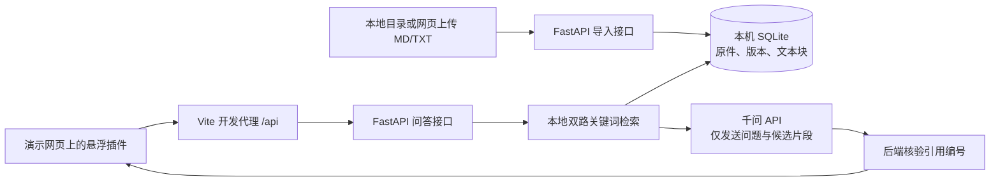

# 11 月 4 日晚 A/B 岗进度汇报与对接报告

> 供两人开会、转发和会后执行。核对时间：2026-11-04 17:10（北京时间）。本报告区分「仓库已实现」「A 电脑本地演示验证」「课程最终要求」。本机知识库 ID、数据库、API Key 和运行中的服务都不会随 GitHub 仓库同步给另一台电脑。

## 一句话说明我们在做什么

用户把产品资料放进知识库，访客在任意网页右下角打开小助手提问。后端先从资料里找相关原文，再让千问依据这些原文组织回答，页面展示答案及文件、行号和原文；资料不足时应说明无法确定。课程还要求把插件**实际接入 Agent Insight**，并完成多轮、流式、反馈、资料管理等能力。

## 今晚可以先口头汇报的版本（约 1 分钟）

我们已经把 A 岗的本地知识库、检索、千问单轮问答接口，与 B 岗的悬浮网页插件接通。在 A 的电脑上，真实浏览器提问“创建评测数据集要先定义什么，之后再补什么？”，页面显示了千问回答和 4 条可展开的引用原文；后端能记录请求、命中数、回答状态及引用数。没有模型密钥时，页面会明确标注“尚未生成答案”并展示检索原文。代码已在 GitHub `main`，提交 `cc40196`。当前仍是独立演示页，尚未在 Agent Insight 项目中安装；课程的多轮、流式、反馈、Word/Excel/PDF 和完整管理功能也还没完成。

## 当前系统怎么走

- **A 岗后端已实现：** Python 3.12、FastAPI、SQLite；CLI 建库和目录导入；网页建库、上传、列文档接口；MD/TXT 解析、原件保留、内容指纹和版本更新、切块；双路关键词检索；`/questions` 原文检索接口；`/answers` 调用百炼 `qwen3.7-plus` 做单轮回答和引用校验。主要代码在 `apps/api/app/`。
- **B 岗前端基础已实现并完成联调：** React + TypeScript + Vite 悬浮插件、独立加载脚本 `embed.js`、`iframe` 隔离、普通网页演示页；现在可输入并发送问题，显示生成状态、错误、答案和引用原文。主要代码在 `apps/web/`。这次发送与答案展示的对接代码由 A/Codex 完成，B 需要拉取并复核，后续由 B 继续维护体验。
- **尚未实现的页面：** 正式的知识库管理网页。目前浏览器 `/docs` 是 FastAPI 自动生成的接口练习页，不等同于交给管理员使用的前端页面。

### 两个最重要的接口

`POST /api/knowledge-bases/{kb_id}/answers` 请求 `{"question":"..."}`。成功响应包含 `answer`、`answer_status`（`generated` 或 `insufficient_evidence`）、`model`、`citations[]`；每条引用带 `label`（如 `S1`）、文件名、版本、起止行和原文。后端无模型密钥且检索有命中时返回 503，前端再调用 `POST /api/knowledge-bases/{kb_id}/questions`，只展示候选原文并标注“尚未生成答案”。知识库不存在为 404，输入不合法为 422，模型服务/格式出错为 502。完整字段见 [问答接口说明](api/answer-generation-v1.md) 与 [检索接口说明](api/question-retrieval-v1.md)。

`kb_id` 由当前环境创建知识库后获得；A 电脑的 `kb_...` 不能直接复制到 B 电脑使用。开发时 Vite 将浏览器的 `/api` 转发到本机 `127.0.0.1:8000`；构建后的静态文件还需要单独配置生产环境的同源 API 转发。

## 已验证的结果与边界

1. **自动检查：** 2026-11-04 后端 `70 passed, 1 skipped`；前端 TypeScript 检查、Vite 构建、`embed.js` 边界检查通过。构建输出中有独立 `embed.js` 无法作为模块打包的提示，这是脚本按原样复制的现有设计；构建本身成功。
2. **真实千问小样本：** 使用仓库中固定的公开 Agent Insight 文档，T04 和 D03 两题生成有引用的回答，N04 无依据收费问题拒答。三题总用量 3444 Token。报告只保存在 A 电脑被忽略的 `storage/qwen-smoke-*.json`；三题是连通性与初步效果验证，不能代表总体准确率。
3. **真实网页联调：** A 电脑演示库导入 4 份公开 MD 文档。无密钥时，从前端提问后端先返回 503，再返回 5 段原文，网页显示“尚未生成答案”。配置密钥后，具体的 D03 问题在网页显示千问回答和 4 条展开式引用。前后端请求链路已由用户实际点击验证。
4. **发现的质量问题：** 较宽泛的“Agent Insight 如何管理实验？”在检索到 5 段后仍返回 `insufficient_evidence`。这是需要分析的真实失败样例：要分别检查检索结果、问题范围、提示词与模型证据判断，不能仅凭“搜到 5 段”断定应该生成答案。
5. **检索开发集：** 18 道有答案题的答案块 Top-1 从 9/18 提高到 12/18，Top-5 仍为 17/18；5 道无答案题都能搜到词面相似片段。这个数字是**检索排序**，不是最终回答正确率；后续要用 B 岗独立准备的新题复测。详见 [本地检索改进记录](learning/08-local-retrieval-improvement.md)。

## 按课程 8 项验收看，目前还差什么

1. **建库和格式：部分完成。** CLI、后端网页接口可建库/导入；MD/TXT 可用。缺管理网页的完整操作流程，以及 Word、Excel、PDF 的解析和选择性目录导入验收。
2. **增删改查：部分完成。** 可新增、列出、重新导入更新；删除、管理员编辑/预览等未形成完整网页功能。
3. **增量更新与问答对：部分完成。** 手动重新扫描/上传时可按内容变化生成新版本；还没有自动监测源文件变化，也没有问答对直接录入。
4. **插件和多轮：部分完成。** 悬浮插件在普通演示网页已运行；聊天框可以连续输入多题，但每题独立发送，**没有把历史上下文传给模型**，所以不算课程要求的多轮问答。
5. **回答和引用：初步打通。** 已有单轮有据回答、拒答状态、可展开原文；还需系统性人工核对答案是否由引用支持，以及将答案内 `[S1]` 等编号做成明确可点的引用入口。
6. **检索与流式：部分完成。** 有两种本地关键词切分后的排序，没有语义检索；回答是整段返回，不是流式输出。
7. **反馈与持续优化：未完成。** 暂无赞同/不赞同、失败问题持久记录与管理员处理流程。
8. **Agent Insight 实际集成：未完成。** 当前使用其公开文档作为资料，并在独立网页测试；还没有把插件装进该开源项目并验证其页面中的使用。

> 课程完成度不能由这次单轮成功演示推断。尤其“回答有据可依”和“实际插件集成 + 多轮”是课程的核心判断项。

## 今晚建议现场演示（5～8 分钟）

1. A 展示仓库 `main` 的联调提交 `cc40196`，说明 B 的 `app` 分支原有界面代码已在 `main`；核对时远端 `app` 没有独有提交、已落后 `main`。B 后续从最新 `main` 开新分支。
2. A 展示本机两个服务：前端 `http://127.0.0.1:5173/`，后端 `http://127.0.0.1:8000/health`。在 A 电脑打开演示页 `http://127.0.0.1:5173/?kbId=本机知识库ID`；实际 ID 可用 `python -m app.cli kb list` 查看，不写入仓库。
3. 问“创建评测数据集要先定义什么，之后再补什么？”，展示回答、展开引用、`datasets.md` 的文件名与行号；同时看 VS Code 后端终端的请求路径、`matches`、`status`、`citations`。每次真实模型提问会产生费用；密钥只在 A 的后端进程内输入，不发给 B 或 GitHub。
4. 展示“Agent Insight 如何管理实验？”的资料不足状态，说明我们如何记录失败样例并改进，而不是隐藏失败。
5. B 现场展示自己接下来要维护的管理页方案或当前代码。请明确“已运行的代码”和“计划中的页面”各是什么。

## 建议两人今晚拍板的 6 件事

每项只需定**负责人、下次展示的具体结果、完成时间**；技术细节可以留给实施时再定。

1. **下一个共同里程碑：**建议优先做“在 Agent Insight 的一个真实页面里加载插件并完成一次有引用的单轮问答”，因为课程第 8 项需要实际集成。若平台安装成本过高，至少明确负责排障的人与可演示的最小目标；不要把独立演示页当成已集成。
2. **B 岗管理页第一版范围：**建议先做列库/建库、选择 MD/TXT 上传、逐文件结果、文档列表；这些后端接口已有。删除、预览、文件夹选择需要先核对接口，再排后续。上传接口可能 HTTP 200 但部分文件失败，页面应读取每个 `files[].status`。现有 `searchable: false` 字段尚未与实际索引状态统一，B 不应直接把它显示成“该文件无法提问”。
3. **下一轮问答体验：**建议 B 先把答案内 `[S1]` 与引用列表对应、资料不足文案和重试体验做好；A 同步分析宽泛问题失败原因。多轮上下文及流式输出是课程要求，但会改变接口契约，先约定会话 ID、历史长度、状态/事件格式再实施。
4. **评测与验收：**建议 B 独立写 10～15 道此前没用于调参的问题，覆盖明确有答案、换一种说法、资料缺失、文档更新后再问；A 跑检索和生成，双方人工核对答案、引用与拒答。把失败题、来源、原因和修改前后结果记录下来。
5. **资料格式与管理优先级：**确认 Word、Excel、PDF、删除/修改、问答对、反馈记录分别何时做、谁负责。建议 A 负责解析、数据和接口；B 负责管理员操作页与提示；共同做一次更新和删除后的查询验收。
6. **协作方式：**B 先拉最新 `main`，在新功能分支提交可运行的小改动；A 负责接口契约、后端与集成检查。合并前互相看一次运行结果。不要提交 `.venv`、`storage`、真实资料或 API Key。两台电脑各自建库会得到不同 ID，演示配置需分别填。

B 若用 Git 命令，先保存或提交自己尚未上传的本地改动，再依次运行 `git switch main`、`git pull origin main`、`git switch -c feat/management-page`；不熟悉命令时可以先在 GitHub 网页阅读本报告和代码，开会时再一起操作。不要对旧 `app` 分支做强制推送。

## 下一轮工作包（建议，会上确认后执行）

- **A 岗优先：**把“如何管理实验？”这道失败题保存为可复测样例，检查 Top-5 原文与模型拒答原因；给 B 一份管理页实际需要的接口/字段清单，并核查 `searchable: false` 与真实索引状态的关系后修正接口；与 B 先定多轮和流式的接口草案。验收物是失败题前后对比、接口示例和可运行后端，不是只写计划。
- **B 岗优先：**在新分支做最小管理页（列库、建库、选 MD/TXT 上传、逐文件状态、列文档）；把答案内引用编号与展开原文关联；准备独立测试题。验收物是从网页亲手创建和上传后成功提问，而不是静态截图。
- **两人共同优先：**选定 Agent Insight 仓库版本并跑起它，在一个真实页面加载 `embed.js`，记录提问与引用是否正常、是否与原页面冲突。只有这一步通过，才能向老师说“已集成到 Agent Insight”。
- **第二批再排：**Word/Excel/PDF、删除编辑、问答对、多轮上下文、流式输出、反馈记录。它们仍是课程要求；顺序与时间要在会上按截止日期决定，不能从清单中删除。

## 散会前记录（直接在会议上填写）

- [ ] 课程提交/答辩日期：`[待填]`
- [ ] Agent Insight 目标仓库与固定版本、运行负责人：`[待填]`
- [ ] 下一次共同演示的完整路径和日期：`[待填]`
- [ ] A 岗本周交付、可验收结果、截止时间：`[待填]`
- [ ] B 岗本周交付、可验收结果、截止时间：`[待填]`
- [ ] 独立评测题负责人、数量和复核方式：`[待填]`
- [ ] 首版管理页范围及暂缓功能：`[待填]`
- [ ] 每周合并与联调时间：`[待填]`

## 可直接发给同学的短消息

> 我把今晚的对接报告放在 `docs/2026-11-04-evening-handoff.md`。现在 `main` 已接通悬浮插件与后端：A 电脑实测网页提问后，千问能返回带 4 条引用的回答；没有 Key 时会显示检索原文。请先看报告中“已验证的结果与边界”和“建议两人今晚拍板的 6 件事”，开会时我们一起确定 Agent Insight 实际集成、管理页第一版范围、独立评测题和本周分工。你的电脑需要自己建库取得 `kb_id`，不要照搬我本机的 ID。
