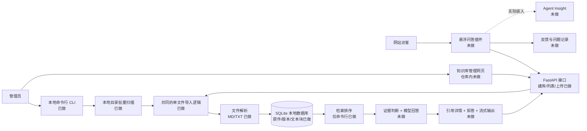
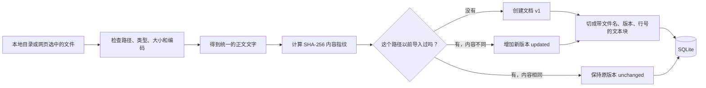
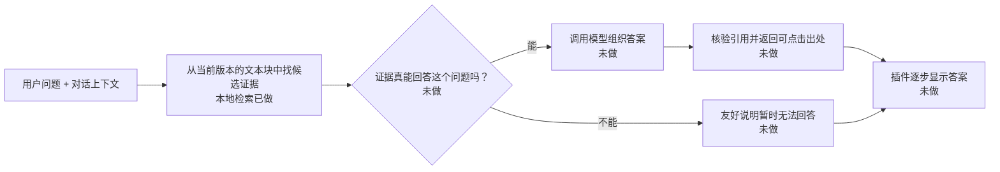

# 项目全貌：从课程要求到当前代码

更新于 2026-10-28。本文是给两位组员看的项目地图。文中的「课程要求」来自老师的任务三；「当前状态」只按本仓库已经存在的代码和测试判断。另一位同学电脑上的页面或计划，若尚未合并进仓库，不在「已实现」之列。

## 先用一句话理解项目

最终产品像一个能放在网站角落的问答按钮：管理员先把资料放进知识库；访客点开按钮提问；系统先在资料里找证据，再据此回答、显示可打开的引用；资料没有答案时如实说不知道。老师还要求把它**实际接入 Agent Insight**，不能只做独立演示。

## 总框架图

图中「已做」指当前仓库可运行；「部分」指只有基础能力；「未做」指还没有可交付的代码。箭头表示数据或请求的方向。

这张图有两条主要路线：**放资料**是左侧的「管理员 → 导入 → 数据库」；**用资料回答**是「访客 → 插件 → 检索 → 判断证据 → 回答」。现在第一条路线基本能跑 MD/TXT，第二条路线只做到了本地找相关段落。

### 资料进入系统时发生什么

「内容指纹」可以理解为给文件内容算一个短标识，用来判断是否真的变化；`created`、`unchanged`、`updated` 分别对应第一次导入、内容未变、内容变了。重新导入本地目录是**手动触发的增量更新**，目前还没有自动监听文件变化。

### 用户提问时最终应该发生什么

**搜到相似段落不等于段落真的回答了问题。** 这是整个项目最重要的质量边界。模型服务/API 的具体供应方、费用和密钥管理方案尚未确定；当前代码没有调用大模型。

## 各部分到底负责什么、做到了哪里

### 1. 管理网页与悬浮插件：让人能操作

管理网页面向管理员：建知识库、挑文件或目录、查看导入结果、维护资料。悬浮插件面向网站访客：弹出聊天框、显示流式回答和引用、收集反馈。两者不是同一个页面。老师要求它们最终能在 Agent Insight 中实际使用。当前仓库没有前端工程；B 岗的本地计划或未合并代码需要另行确认。

### 2. HTTP 接口：网页和后端的接头

[main.py](../../apps/api/app/main.py) 创建 FastAPI 应用；Uvicorn 是启动它并接收 HTTP 请求的服务器。[api_routes.py](../../apps/api/app/api_routes.py) 目前提供：

- `GET /health`：只确认服务活着。
- `POST /api/knowledge-bases`、`GET /api/knowledge-bases`：创建、列出知识库。
- `GET /api/knowledge-bases/{kb_id}/documents`：列出已导入文档。
- `POST /api/knowledge-bases/{kb_id}/documents/import`：上传 MD/TXT，可一次传多个文件。

浏览器的 `/docs` 是 FastAPI 自动生成的**接口练习页**，不是最终管理网页或问答插件。上传时要选择文件，让浏览器发送文件内容；直接输入 `D:\...\intro.md` 只会发送路径文字。现有上传限制是每次最多 20 个文件、每文件最多 5 MiB。网页搜索、删除、问答、引用、流式输出、反馈等接口还没有。

### 3. 本地命令行：不用网页也能跑后端

[cli.py](../../apps/api/app/cli.py) 已能建库、列库、扫描目录导入、列文档、列文本块、搜索。CLI 是开发和验收入口之一；课程明确要求既能从 CLI，也能从网页创建知识库。它和网页上传最后调用同一套导入逻辑，不会产生两种不同的文件规则。

### 4. 文件导入与解析：把资料变成可处理的文字

[directory_scan.py](../../apps/api/app/directory_scan.py) 找本地目录里的受支持文件；[import_service.py](../../apps/api/app/import_service.py) 组织批量导入；[text_parser.py](../../apps/api/app/text_parser.py) 目前只接受 UTF-8 的 `.md`、`.txt`（可带 BOM），并统一换行符。Word、Excel、PDF 尚未实现。网页上传还会检查文件名、相对路径、重复路径、大小，避免不合法请求写入数据库。

### 5. SQLite 数据库：把资料与历史保存下来

[knowledge_store.py](../../apps/api/app/knowledge_store.py) 管四类核心数据：知识库、文档、文档版本、文本块。默认数据库文件在 `storage/knowledge.sqlite3`，**只在本机保存，不提交到公开 GitHub**。同一路径再次导入时用 SHA-256 判断内容是否改变；改变则增加版本，未改变则返回 `unchanged`；解析失败不会覆盖原本可用的版本。原文件字节副本也会保留。现在没有网页删除、文档编辑或直接录入问答对的能力。

### 6. 文本切块：让长文能被定位和引用

[chunking.py](../../apps/api/app/chunking.py) 将长文拆成较短的原文片段。当前策略按 Markdown 标题、段落等边界切分，目标上限 600 个字符、相邻块重叠 80 个字符；每块保存来源文件、版本、标题、字符位置与行号。这样以后回答引用才能指向原文位置。**已保存出处不代表引用功能已完成**；目前还没有让用户点击查看引用详情的接口和界面。

### 7. 检索：从许多文本块里找候选资料

[retrieval.py](../../apps/api/app/retrieval.py) 只检索文档的当前版本，用「相邻中文双字」和 `jieba` 分词两路提取关键词，各自用 BM25 风格公式评分，再合并排序。搜索结果带文件、版本和行号；分数只用于**排序**，不是答案正确率。当前只能在 CLI 中搜索，没有给前端用的搜索接口，也没有向量/语义检索。API 返回的 `searchable: false` 表示尚未提供完整的网页检索问答能力；它不否认数据库里已经存了块、CLI 已经能试搜。

### 8. 回答、引用、拒答与反馈：产品最关键的后半段

这一部分尚未实现。未来要做的是：判断候选段落能否支持回答，再让模型依证据写答案；引用必须能对应到真实的文件与原文；证据不足时拒答；多轮对话要处理上下文；答案要流式显示；反馈和未答问题要留存。老师把**回答准确且有据可查**列为核心验收维度，因此不能仅把检索结果送给模型就算完成。

### 9. 评测：先用题目量出「找资料」的效果

[evaluation.py](../../apps/api/app/evaluation.py) 每次建临时数据库，导入固定资料，跑带标注的问题，统计正确答案块排在第几名。`evals/demo/` 是虚构演示集；`evals/agent_insight/` 固定了四篇公开 Agent Insight 文档和团队编写的题，不是老师指定的官方题库。2026-10-28 在当前代码重跑：18 道有答案题中，答案块 Top-1 为 **12/18**、Top-5 为 **17/18**；5 道无答案题都搜到了貌似相关的内容（真正无命中 **0/5**）。这说明检索有基础，但**不能据此宣称问答准确或会拒答**。仍需独立留出题与端到端问答验收。

### 10. Agent Insight 集成：最终交付环境

课程第 8 项验收要求把插件实际放进 Agent Insight 项目，在真实页面展示并响应问题。目前只把公开 Agent Insight 文档当成**检索评测资料**；尚未把代码接进 Agent Insight。老师未给指定仓库，我们暂以公开 openEuler 镜像作为资料来源，不能把「用它的文档测试」说成「已经集成它的网页」。

## 对照老师的八项验收，当前处在什么位置

1. **知识库创建：部分。** CLI 和 HTTP 建库、MD/TXT 本地目录导入及网页上传接口已做；正式管理页面和 Word/Excel/PDF 未做。
2. **知识库管理：部分。** 已能新增、查询；修改靠重新导入，网页删除与完整增删改查未做。
3. **增量同步与问答对：部分。** 手动重新导入能识别文件变化；自动同步与直接录入问答对未做。
4. **插件与多轮问答：未做。** 没有悬浮图标、聊天框、上下文处理或可嵌入构建物。
5. **准确回答与引用：未做。** 保存了未来可引用的来源位置，但没有回答、引用核验、引用详情或可靠拒答。
6. **检索与流式体验：部分。** 本地关键词排序与开发集评测已做；语义检索和流式回答未做。
7. **反馈与持续优化：未做。** 没有点赞/点踩、未答问题记录或补库闭环。
8. **Agent Insight 集成：未做。** 目前只有以其公开文档做的独立检索评测。

所以当前应称为**后端资料处理与本地检索原型**，不能称为完成的知识库问答插件。完整自动测试在本机为 `60 passed, 1 skipped`；这证明已写功能通过对应测试，不代表八项课程验收已经通过。

## 哪些是课程规定，哪些是我们自己选的

- **课程规定的结果：** 两种建库入口、常见格式、增删改查、增量更新、问答对、可嵌入插件、多轮问答、可核验引用、无法回答时拒答、检索优化、流式输出、反馈、Agent Insight 实际集成。
- **我们目前的实现选择：** Python 3.12、FastAPI/Uvicorn、SQLite、本地 MD/TXT、文本块、双路关键词检索、pytest、GitHub。老师没有指定必须用这些技术。
- **尚待两人决定：** B 岗前端具体技术与页面合同、是否及何时加入语义检索、模型 API/本地模型的选择、部署方式、与 Agent Insight 的实际接入方式。现在的图画出了这些位置，**没有把待选方案写成已完成事实**。

## 建议如何用这张地图学代码

先沿「资料流」走：`main.py` / `cli.py` → `api_routes.py` / `import_service.py` → `text_parser.py` → `knowledge_store.py` → `chunking.py`。再沿「提问流」走：`retrieval.py` → `evaluation.py`。每走到一个文件，只问三个问题：它收到什么、做了什么、交给谁。对应的小实验见 [从零学习路线](00-from-zero-to-current.md)；前后端接口字段见 [A/B 接口约定](../api/knowledge-base-v1.md)。
