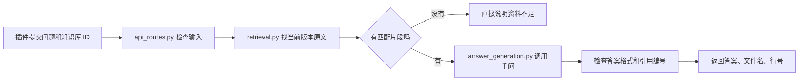

# 第 09 课：模型答案怎样产生

更新于 2026-11-04。这一课对应 A 岗新增的单轮答案接口。先读[项目全貌](00-project-architecture.md)，再看这条流程。

**检索负责找资料，模型负责把资料组织成自然语言。** 数据库中的原文副本和版本仍在本地；调用云端模型时，问题与这次选中的片段会发给阿里云。现在使用 `qwen3.7-plus`，每次最多放入 8 个片段，模型输出限制为 600 Token。

## 从代码入口往下看

1. [api_routes.py](../../apps/api/app/api_routes.py) 的 `/answers` 接口：检查知识库和问题，调用现有 `search_knowledge_base()`，再调用 `generate_answer()`。它把结果转成前端可读的 JSON。
2. [retrieval.py](../../apps/api/app/retrieval.py)：只返回指定知识库当前版本中，排名靠前且有关键词匹配的片段。检索分数只表示排序，不能当作答案可信度。
3. [answer_generation.py](../../apps/api/app/answer_generation.py)：给片段临时编号 `S1`、`S2` 等；把问题和片段发给千问；要求模型返回 JSON；检查它引用的编号是不是本次真正提供过的片段。没有片段时直接说明资料不足，不请求模型。
4. [test_answer_api.py](../../apps/api/tests/test_answer_api.py) 和 [test_answer_generation.py](../../apps/api/tests/test_answer_generation.py)：用模拟模型响应检查接口、配置缺失、引用越界等情况；测试不会消耗模型费用。

例如，检索找到了 `guide.md` 第 1～2 行，后端发给模型的证据会标成 `[S1] guide.md v1 L1-2`。模型若回复引用 `S1`，后端能找到真实文件与行号；若回复 `S999`，后端拒绝把它当成有效答案。**编号真实仍不等于整句话正确**，还要用固定题目人工检查答案与原文是否一致。

模型可能在答案正文写 `[S1]`，同时在结构化引用列表里返回 `S1`。后端会检查正文中的编号确实出现在引用列表，并将 `label: "S1"` 和文件、行号一起返回给前端。引用列表的先后顺序不能代替编号。

## 怎样看测试结果

从仓库根目录进入 `apps/api`，运行 `..\..\.venv\Scripts\python.exe -m pytest`。测试通过只说明代码连接与约定行为成立。当前机器未配置真实 `DASHSCOPE_API_KEY`，因此还没有证明账号、网络和真实模型的回答质量。配置方法与返回格式见[答案接口契约](../api/answer-generation-v1.md)。

下一步 A 岗用 Agent Insight 的真实资料准备“能回答、不能回答、容易误答”三类问题；B 岗按接口契约展示答案状态及引用。两人联调后再决定是否切换 DeepSeek 对照，或换更便宜的千问 Flash。

真实账号准备好后，按[第 10 课：第一次真实千问联调](10-real-qwen-smoke.md)运行三题小实验；报告会留在本地 `storage/`，不会进入 Git。
